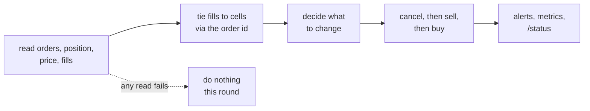
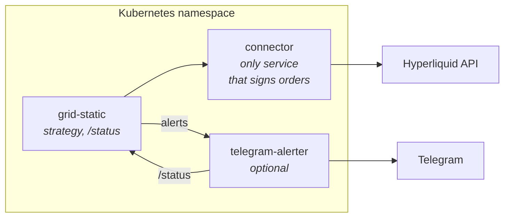

# gridstatic

A grid trading bot for [Hyperliquid](https://hyperliquid.xyz), run on Kubernetes, that keeps no
database. Its state lives in the exchange's own order metadata: every order the bot places carries
a client order id (cloid), a 128-bit field that Hyperliquid stores with the order and returns with
it ([Hyperliquid API docs](https://hyperliquid.gitbook.io/hyperliquid-docs/for-developers/api/exchange-endpoint)).
The bot writes into it which grid and which cell the order belongs to. Every round it reads the
open orders with that metadata, the position and the fills, and repairs the difference with the
grid you configured. A restart, a crash or a network outage is just another round.

[](https://github.com/njwgroeneveld/gridstatic/actions/workflows/deploy-grid-static.yml)
[](https://github.com/njwgroeneveld/gridstatic/actions/workflows/deploy-connector.yml)
[](https://github.com/njwgroeneveld/gridstatic/actions/workflows/deploy-telegram-alerter.yml)
[](https://github.com/njwgroeneveld/gridstatic/actions/workflows/publish-chart.yml)

> A personal project, built to learn reliability engineering on a system that moves money. It runs
> on Hyperliquid's testnet by default, currently with a BTC grid and a Nasdaq-100 grid. The grids
> are long only: they buy below the price and sell above it, and never go short. Not financial
> advice, and no claim that a grid makes money.

---

## What it shows

| | |
|---|---|
| **One source of truth** | Every order carries a label that the exchange stores with it: which grid placed it, and for which cell. So the open orders, the position and the fills on the exchange are the bot's whole state, and there is no second copy to keep in step. [Why this instead of a database](docs/design.md#why-the-orders-carry-their-own-data). |
| **Fail-safe by default** | Every 30 seconds the bot runs a round: it reads the exchange (open orders, position, price, fills), works out what to cancel and place, and does it. If any read fails, that round places and cancels nothing: a failed read of the open orders must never look like "no orders", or the bot would place them all again. If the position holds more BTC (or whichever asset the grid trades) than the bot's own orders explain, for example after a manual trade, the grid goes *on hold*: it places no new buys, but still places sells, so what it holds can be sold. A config that is not safe to trade with makes the bot refuse to start. |
| **Incident-driven design** | Each incident is written up with its root cause and fix in [`docs/postmortems.md`](docs/postmortems.md), and has a regression test. |
| **Tested where it breaks** | Every decision is made in one function without network calls, so each situation can be tested without an exchange. Each safety rule was removed once on purpose, to check that a test then fails. Assumptions were checked against the real thing, not a mock: the SDK's actual signatures, the testnet API's actual answers, and the Kubernetes files the Helm chart actually generates. |
| **Operable** | Helm chart, multi-arch images, CI gates, a one-command installer, Telegram alerts, Prometheus metrics. |

---

## How it works

The price range is cut into lines. Each pair of neighbouring lines is a **cell**: buy on the lower
line, sell on the upper. A filled buy gets a sell; a filled sell gets its buy back.

An example: a BTC grid from 80,000 to 88,000 with five lines, while the price is 83,500.

| Cell | Buys at | Sells at | Resting on the exchange now |
|---|---|---|---|
| 3 | 86,000 | 88,000 | nothing: a buy above the price would fill at once |
| 2 | 84,000 | 86,000 | a sell at 86,000, for the BTC it bought |
| 1 | 82,000 | 84,000 | a sell at 84,000, for the BTC it bought |
| 0 | 80,000 | 82,000 | a buy at 80,000 |

Five lines make four cells. Buys rest only below the price, and the top line has no cell above it.

Each buy is sized from the grid's share of the realised equity on its dex, every round, so
profit is reinvested without the bot keeping a record of it.



Four ideas carry the design:

- **The order id is the memory.** Every order's client order id encodes its grid and its cell, so
  after a restart the bot reads the book and knows where it stands, with no record and no price
  matching.
- **One rule for what a cell holds.** What a cell has bought but not yet put up for sale is what
  it bought after its current sell went out. That covers partial fills, restarts and a crash halfway through replacing an order.
- **The position has to add up.** Before any new buy, the whole position must be explained by the
  bot's own orders. If not, the grid holds and alerts. A buy too few costs a cycle; a buy
  too many is [incident 1](docs/postmortems.md#1-eight-buys-on-one-line-2026-09-09).
- **Protection lives on the exchange.** The optional stop-loss is a reduce-only stop order, sized
  to the position every round, so it fires even when the cluster is down. After a stop the grid
  resumes on its own once the price is back inside.

How each of these works, with examples: [docs/design.md](docs/design.md#the-exchange-is-the-only-source-of-truth).

It also trades HIP-3 markets: stocks and indices on third-party perp dexes, such as the
Nasdaq-100 (`xyz:XYZ100`). It decides from the mark price, not the mid: the testnet order books
are thin, so the mid moves with the bot's own orders.

---

## Architecture



Three small FastAPI services, each with its own image (amd64 + arm64) and test suite, talking over
ClusterIP. Nothing is exposed outside the cluster.

Only the connector holds a key, and it is the key of a Hyperliquid **API wallet**: a key the
account approves to trade on its behalf, which cannot withdraw or move funds. A leaked key could
place orders, but never drain the account. The connector asks the exchange whether its key is an
API wallet and whether the account is a subaccount, and signs accordingly
([which key to use](docs/operations.md#which-key)).

---

## Postmortems

| Incident | Root cause | Now |
|---|---|---|
| Eight buys on one line | A filled line looked free: the database matched by price, the exchange filled at another | A cell is never free while the position says otherwise |
| Prices arrived as strings | `Decimal` → JSON through the database service; mocks returned floats | No database; verify at the real boundary |
| A shared free database dropped requests | One free cloud Postgres, shared by several projects, stood between the bot and its state | No database |
| Two grids on hold for days, unseen | No metric was ever collected; and a stop fill did not end what the cells held | Alerts outside the bot; a stop resets every cell |
| Rounds took seconds | Every grid read every dex, and the whole fill history, one request after another | Each grid now reads only its own dex and only recent fills, in two parallel batches: a round takes half the time |

The full write-ups are in [`docs/postmortems.md`](docs/postmortems.md).

---

## Quick start

Needs a Kubernetes cluster, `kubectl`, `helm` and a Hyperliquid **testnet** account.

```bash
curl -fsSLO https://raw.githubusercontent.com/njwgroeneveld/gridstatic/master/install.sh
bash install.sh
```

It asks for your testnet key (hidden input), checks it with Hyperliquid before installing
anything, optionally sets up Telegram, installs the chart and verifies that the bot runs.

**Nothing trades yet after that.** The values file it writes, `gridstatic-values.yaml`, holds two
grids, BTC and the Nasdaq-100 (`xyz:XYZ100`), both with `active: false`, so you choose which one
starts. To start one:

1. check its bounds against the current testnet price (`lower` below it, `upper` above it);
2. for the Nasdaq-100, move USDC to the `xyz` dex first: it keeps a balance of its own;
3. set `active: true` on it and run
   `helm upgrade gridstatic oci://ghcr.io/njwgroeneveld/charts/gridstatic -n gridstatic -f gridstatic-values.yaml`.

Details are in [Starting a grid](docs/operations.md#starting-a-grid). Configuration, HIP-3
markets, the stop-loss, holds and the move to mainnet are in
[`docs/operations.md`](docs/operations.md).

---

## Stack

| | |
|---|---|
| Services | Python 3.11, FastAPI, httpx, `hyperliquid-python-sdk` |
| Tests | pytest, 283 tests, with the decision logic covered case by case |
| Platform | Kubernetes, Helm, GitHub Actions, multi-arch images on ghcr.io |
| Operations | Prometheus metrics with an optional dashboard and alerts ([`monitoring/`](monitoring/README.md)), Telegram alerts, a read-only consistency check (`tools/gridcheck.py`) |

```
services/grid-static/       strategy: src/reconcile.py decides, src/strategy.py acts
services/connector/         the only service that talks to Hyperliquid
services/telegram-alerter/  alerts and the /status command
chart/                      Helm chart
install.sh                  one-command installer
tools/gridcheck.py          independent check of a grid against the exchange
monitoring/                 optional: Grafana dashboard, alert rules, scrape targets
docs/                       design.md (why), operations.md (how)
```

---

## Status

Running on Hyperliquid testnet since October 2026. Proven on real data: placing and recognising
orders, tying a fill to its cell, the stop order on the exchange, fills on a HIP-3 market,
reinvesting realised profit, and trading through an API wallet for a subaccount.
