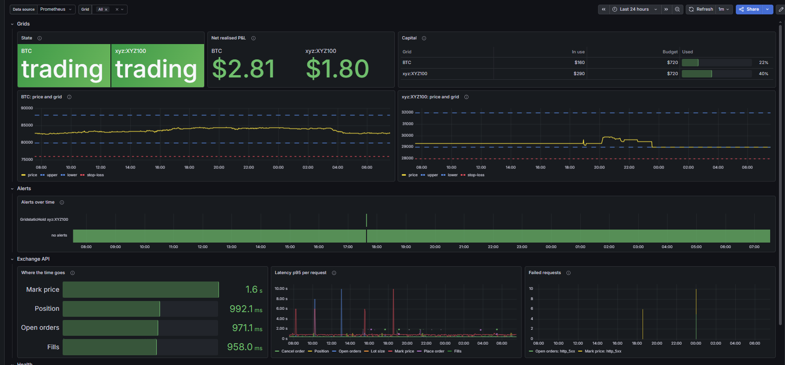
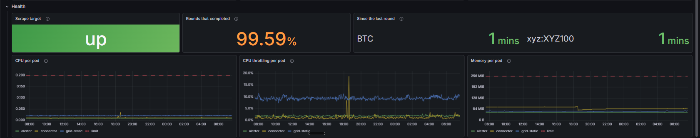

# Monitoring (optional)

Not part of the installation: a grid runs without any of this. grid-static and the connector
serve Prometheus metrics on `:8080/metrics/`; this folder holds what turns them into a dashboard
and alerts, for a cluster that runs
[kube-prometheus-stack](https://github.com/prometheus-community/helm-charts/tree/main/charts/kube-prometheus-stack).

| file | what it is |
|---|---|
| `servicemonitors.yaml` | lets Prometheus scrape grid-static and the connector |
| `alerts.yaml` | two alert rules, `GridstaticDown` and `GridstaticHold` |
| `dashboard.json` | the Grafana dashboard |



*Two grids on Hyperliquid's testnet: BTC and the Nasdaq-100 (`xyz:XYZ100`, a HIP-3 market).*

## Reading the dashboard

One screen, four rows. Every panel also explains itself under its ⓘ.

### Grids — how each grid is doing

| panel | what it shows | how to read it |
|---|---|---|
| **State** | *trading* or *HOLD*, per grid | On hold the grid places no new buys, because its position does not add up to its own orders. Sells and the stop still go out. The reason is in the log and in `/status`; see [When the grid holds](../docs/operations.md#when-the-grid-holds). |
| **Net realised P&L** | closed profit minus fees over the selected time range | Taken from the exchange's own `closedPnl`, so a stop-out counts as the loss it was. It counts from when the pod started; set the range to a day or a week. |
| **Capital** | per grid: *in use*, *budget* and the share used | Both as position value, leverage included. *Budget* is every cell bought: size per line × leverage × cells. *In use* is the coin held now × the mark price. A grid only holds coin for the cells below the price that filled, so with the price near the top little is in use — that is the design, not idle money. The size per line follows the realised equity of the grid's dex, so the budget grows with profit; coin bought earlier keeps the size of its day, which can make *used* look high right after the size shrank. |
| **Price and grid** | one panel per grid: the mark price (yellow) between the highest and lowest line (blue, dashed), and the stop-loss (red, dotted) | Inside the bounds the grid trades. Below the lowest line there is nothing left to buy; above the highest nothing left to sell. Below the stop the position is closed, and the grid starts over once the price is back inside. |
| **Realised equity** | the money each grid sizes from, and the total, over time | Account value of the grid's dex minus the unrealised P&L on it: it rises with closed profit and falls with losses, fees and funding, not with the price of an open position. A transfer between the dexes moves the two grid lines and leaves the total alone. 14 days, as long as Prometheus keeps them; Hyperliquid's portfolio page goes back further. |

### Alerts — when something needed attention

**Alerts over time** shows each alert as a row: orange while *pending* (its condition holds, its
`for` time is running), red once *firing* (sent to Alertmanager, and from there to e.g. Telegram).
The green *no alerts* row fills the time when none was. The two rules and what to do when they
fire are [below](#alerts).

### Exchange API — what the bot waits for

The connector is the only service that talks to Hyperliquid, and it times every request where it
goes over the network. Hyperliquid has two endpoints: `/info` to read and `/exchange` to act. The
panels name the request types:

| on the dashboard | Hyperliquid request | when |
|---|---|---|
| Open orders | `frontendOpenOrders` | every round |
| Mark price | `metaAndAssetCtxs` | every round |
| Position | `clearinghouseState` | every round |
| Fills | `userFillsByTime` | every round |
| Place order, Cancel order | `order`, `cancel` | when the grid trades |
| Order lookup | `orderStatus` | when a fill comes in for an order the bot does not know yet |
| Startup check, Lot size, Set leverage, Spot balance | `allMids`, `meta`, `updateLeverage`, `spotClearinghouseState` | only when the bot starts |

| panel | what it shows | how to read it |
|---|---|---|
| **Where the time goes** | seconds per minute spent waiting, per request type | How slow × how often: the longest bar is what makes a round slow. Green below 10 s a minute, orange from 10, red from 20 — a third of the time waiting on one kind of request. |
| **Latency p95 per request** | per request type, the time 95% of requests were answered within | The 95th percentile instead of the average, because the average hides the slow ones. Single spikes are the testnet; a line that stays high is not. |
| **Failed requests** | how many requests failed in each bar's slice of time | *rejected* (answered, but refused — e.g. under the $10 minimum), *rate_limited*, *http_4xx/5xx*, *timeout*, *connection* (most likely: the node lost its network). Empty is good. |

Only request types made in the time range are shown; the start-up ones disappear after a while.

### Health — is the service itself all right



| panel | what it shows | how to read it |
|---|---|---|
| **Scrape target** | whether Prometheus reaches grid-static | *DOWN* for 5 minutes fires `GridstaticDown`. |
| **Rounds that completed** | completed rounds ÷ all rounds over the time range | A simple SLO. A round is skipped when the exchange cannot be read — the bot then acts on nothing. A few skipped rounds on testnet are normal; a falling line is not. |
| **Since the last round** | seconds since each grid's last complete round | A round runs every 30 seconds, so 30–60 s is normal. Orange from 2 minutes, red from 5: the bot is up but stuck. |
| **CPU per pod** | CPU per service, in cores, with the limit dashed | Far below the limit is normal. |
| **CPU throttling per pod** | the share of time a container hit its CPU limit and had to wait | The one the average hides: grid-static uses a tenth of its limit on average, yet hits it in short bursts. Up to ~10% costs milliseconds; a steady rise means the limit is too low. |
| **Memory per pod** | memory per service, with the limit dashed | At the limit Kubernetes kills the container (OOM). A line that only climbs is a leak. |

## Applying it

The files are written for the default install — release `gridstatic` in namespace `gridstatic` —
and for a kube-prometheus-stack that selects on `release: monitoring`. With other names, change
the `namespace` and `release` lines first.

```bash
kubectl apply -f monitoring/servicemonitors.yaml -f monitoring/alerts.yaml

# The dashboard, for Grafana's sidecar (kube-prometheus-stack looks for this label). The key is
# the file name the sidecar writes, shared with every other dashboard: keep it distinct.
kubectl -n gridstatic create configmap gridstatic-dashboard \
  --from-file=gridstatic.json=monitoring/dashboard.json
kubectl -n gridstatic label configmap gridstatic-dashboard grafana_dashboard=1
# ... or import monitoring/dashboard.json by hand: Dashboards → New → Import.
```

## Metrics

| metric | what it is |
|---|---|
| `grid_realized_gain_usd_total`, `grid_realized_loss_usd_total`, `grid_fees_usd_total` | `closedPnl` and fees of the grid's fills on the exchange, **stop-outs included**. Net realised P&L over a range is `increase(gain) - increase(loss) - increase(fees)`. |
| `grid_on_hold` | 1 while new buys are held back — see [When the grid holds](../docs/operations.md#when-the-grid-holds) |
| `grid_mark_price`, `grid_lower_bound`, `grid_upper_bound`, `grid_stop_loss_price` | the price and the grid around it |
| `grid_budget_usd`, `grid_position_value_usd` | the position value with every cell bought, and the position value now — both leverage included |
| `grid_realised_equity_usd{dex}` | account value of the dex minus the unrealised P&L on it — what the order size is computed from; one value per dex, so add dexes up after `max by (dex)` |
| `grid_last_round_timestamp_seconds` | when the last complete round ended: a bot can be up and still be stuck |
| `connector_hl_request_duration_seconds{api, request}` | how long Hyperliquid takes per request type (`userFillsByTime`, `frontendOpenOrders`, `order`, …), measured in the connector where it goes over the network |
| `connector_hl_requests_total{api, request, outcome}` | the same requests by outcome: `ok`, `rejected` (answered but refused), `rate_limited`, `http_4xx`, `http_5xx`, `timeout`, `connection` |
| `grid_profit_usd` | the bot's own view of completed buy→sell cycles. It starts at zero on every restart and leaves out stop-outs; use the realised counters above for P&L. |

The realised counters count each fill once, from the moment the pod starts. Fills that happen
while the pod is down are not counted.

## Alerts

Prometheus evaluates the rules and Alertmanager sends them wherever you route alerts — so unlike
the Telegram messages the bot sends itself, they also arrive when the bot is down.

### GridstaticDown

No healthy grid-static target for 5 minutes. No round runs, so nothing is bought or sold; the
stops on the exchange still protect the positions.

1. `kubectl -n gridstatic get pods` — is the pod there? `0/1`, `CrashLoopBackOff`, `Pending`?
2. `kubectl -n gridstatic describe pod -l app=gridstatic-grid-static` — the events say why it
   does not start: an image that cannot be pulled, a node that is gone, an OOM kill.
3. `kubectl -n gridstatic logs deploy/gridstatic-grid-static --previous` — the last words of a
   crashed pod. "Refusing to start" means a configuration error; the message names it.
4. Pod running but the alert still fires? Then Prometheus cannot reach it: check that the
   ServiceMonitor still selects the Service (`kubectl -n gridstatic get endpoints`).

### GridstaticHold

A grid has placed no new buys for 30 minutes because its position does not add up. Sells and the
stop still go out.

1. Find the reason: `kubectl -n gridstatic logs deploy/gridstatic-grid-static | grep "on hold"`,
   or the `hold` field in `/status`.
2. Look it up in [When the grid holds](../docs/operations.md#when-the-grid-holds) — every reason
   there has its fix.
3. `tools/gridcheck.py` shows, cell by cell, what the bot sees and what it would do next.
